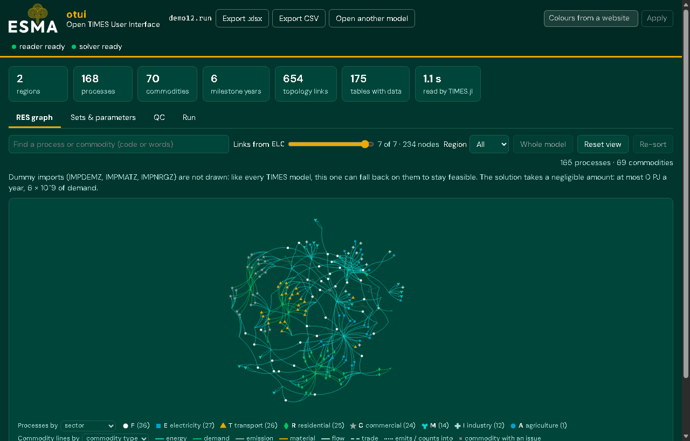
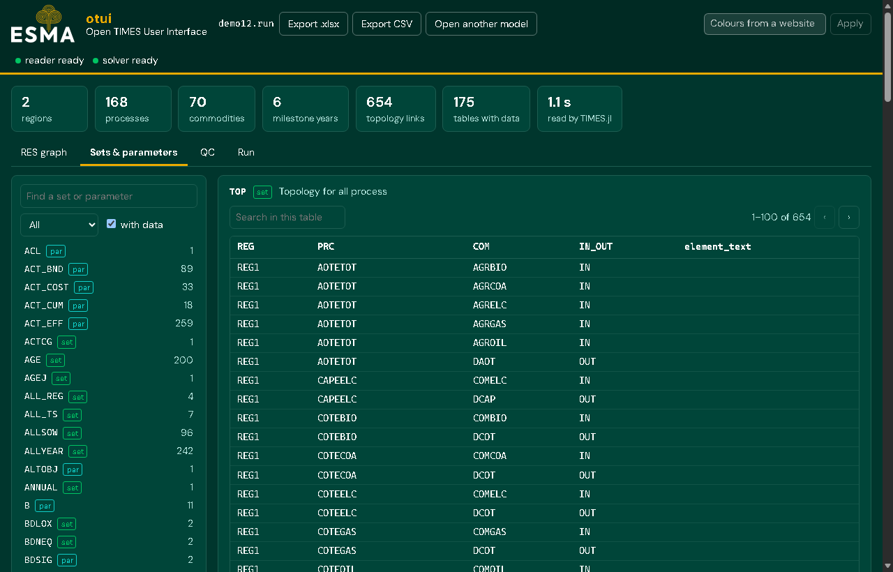
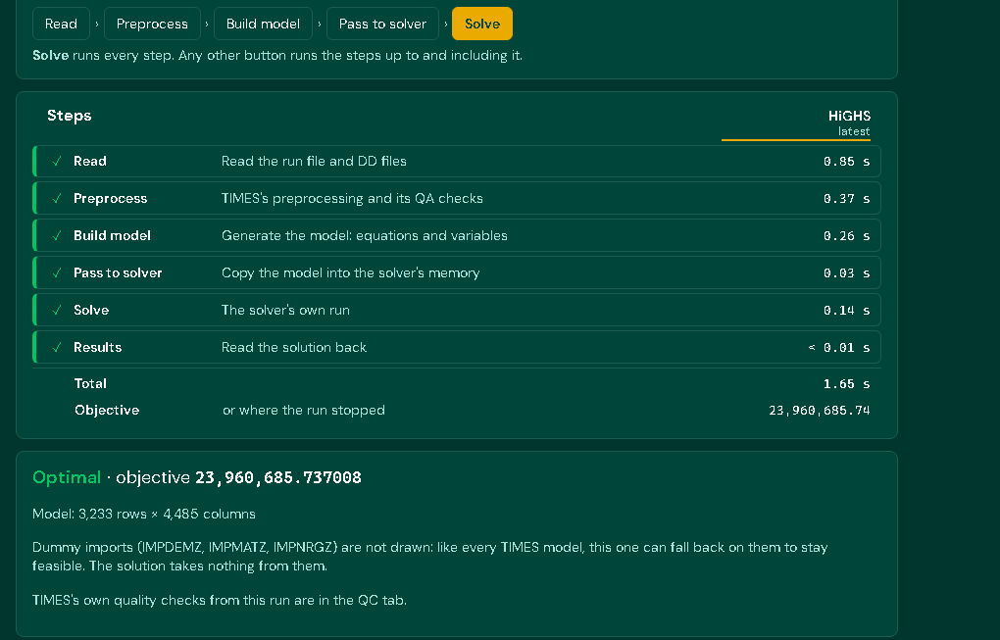

# otui: Open TIMES User Interface

otui is a browser-based, open-source graphical interface for TIMES models,
built on native TIMES syntax (sets and parameters as in DD files). It is for
TIMES modellers and students, including those who do not work in code.

Version 0.1.0 is a **preview**. Drop a model's run file and DD files on the
page, then browse its sets and parameters, see its network, check it, solve
it and export it. Solving with TIMES.jl, TIMES in Julia, is experimental.
Editing models through Excel, LibreOffice and CSV files comes next: see the
[roadmap](docs/roadmap.md).



## Try it online

[](https://codespaces.new/esma-ie/otui?quickstart=1)

GitHub Codespaces runs otui for you on a cloud computer, in your browser, with
nothing to install. You need a free GitHub account. The first start takes a
few minutes, then otui opens in a new tab. If your browser blocks the tab,
open port 8642 from the **Ports** tab. Next time, the same button offers to
resume your codespace.

To keep your models on your own computer, install otui instead (see the
[Quickstart](#quickstart)).

### What runs where

| | Installed on your computer | In a GitHub codespace |
| --- | --- | --- |
| Where otui runs | your computer | a cloud computer that GitHub runs for you, under your GitHub account |
| GitHub account | not needed | needed (a free one) |
| The models you add | stay on your computer, in `~/.otui/workspace` | are uploaded to your codespace. Only you can connect to it; ESMA cannot see it. |
| Who can open otui's page | only your computer (`127.0.0.1`) | only you, signed in to GitHub (a private port) |
| Cost | free | your account's monthly Codespaces allowance: 120 core hours and 15 GB-month storage on GitHub Free (180 and 20 on Pro). otui's codespace has 4 cores, so that is 30 hours a month on GitHub Free. Use beyond the allowance is billed to you only if you have set up billing for Codespaces ([GitHub's pricing](https://docs.github.com/en/billing/concepts/product-billing/github-codespaces)). |
| When it stops | when you press Ctrl+C | when you stop it, or after 30 idle minutes (GitHub's default) |
| Removing it | `uv tool uninstall otui`, then delete `~/.otui` | delete it at [github.com/codespaces](https://github.com/codespaces). GitHub deletes a stopped codespace after 30 days (its default). |

Either way, otui downloads TIMES.jl and the open models from GitHub, which
needs no account. **Report this run** opens an issue on GitHub, and submitting
it needs a GitHub account.

## Quickstart

You need two free tools, then otui. Everything goes into your own user
folders: no administrator rights, nothing runs at start-up, and nothing is
installed through the browser.

**1. Julia and uv**, from their official installers:

| | Julia (through [juliaup](https://julialang.org/install/)) | [uv](https://docs.astral.sh/uv/getting-started/installation/) (Python tools) |
| --- | --- | --- |
| Windows | `winget install --id Julialang.Juliaup -e` | `winget install --id astral-sh.uv -e` |
| macOS | `brew install juliaup` | `brew install uv` |
| Linux | `curl -fsSL https://install.julialang.org \| sh` | `curl -LsSf https://astral.sh/uv/install.sh \| sh` |

Open a new terminal after installing them, so it finds them.

**2. otui**, in a terminal:

```sh
uv tool install otui
otui julia-setup     # once: downloads TIMES.jl and its Julia packages (10-20 minutes)
otui serve           # then open http://127.0.0.1:8642 in your browser
```

**3. A model.** Drop a model's `.run` file and its `.dd` files on the page,
or a folder or a `.zip` of them, or click **Try the demo model** for
TIMES_Demo's demo12. **Try OTNYC**, **Try OTCGEN** and **Try OTUS9r** open
ESMA's open TIMES models (CC BY-SA 4.0): New York City, Generative COMET and
the US in 9 regions. Then:

- browse the network in **RES graph**: search for a process or commodity, and
  see the dead ends otui found;
- read every set and parameter in **Sets & parameters**, and export them all
  as `.xlsx` or CSV;
- see TIMES's own checks and otui's in **QC**;
- solve it in **Run**, with TIMES.jl and the open-source HiGHS solver. With
  more than one solver, or GAMS TIMES installed, **Parity** compares the
  objectives across codes and solvers. If something goes wrong, or TIMES.jl
  does not translate a feature your model uses yet, **Report this run**
  makes a zip and opens an issue with the details filled in;
- see the results in **Results**: capacity, new capacity and flows in and out
  (VAR_Cap, VAR_Ncap, VAR_FIn, VAR_FOut) as tables and ready-made charts,
  filtered by process, commodity, their sets, period and timeslice; compare
  runs as differences, side by side or a heatmap (a run is a scenario, the run
  file that picks the DD files to include, solved with one solver, shown as
  `<scenario>.<solver>`, such as `demo12.highs`); and export the results as Parquet, DuckDB, CSV or Excel, and the
  charts as SVG, PNG, JPEG or Excel charts to edit.

| Sets & parameters | Run |
| --- | --- |
|  |  |

Stop otui with Ctrl+C in its terminal.

### What otui installs, and where

| What | Where | From |
| --- | --- | --- |
| Julia | your user folder (`~/.julia/juliaup`) | julialang.org |
| uv and otui | your user folder (`~/.local/bin`, uv's tool folder) | astral.sh, the Python Package Index |
| TIMES.jl and its Julia packages (JuMP, HiGHS, ...) | `~/.julia`, with otui's two environments in `~/.otui/julia` and `~/.otui/julia-latest` | github.com/esma-ie/timesjl, the Julia package servers |
| The models you drop | `~/.otui/workspace` | your computer |

- **The browser installs nothing.** The page only talks to the otui server
  running in your terminal. That server listens on `127.0.0.1`, so other
  computers cannot reach it.
- **Network use.** `otui julia-setup` downloads the packages above. Each
  `otui serve` asks GitHub whether TIMES.jl has a newer version, and if so
  builds it in the background for the next start (see
  [Which TIMES.jl](#which-timesjl)). `otui serve --timesjl pinned` turns
  that off. **Try OTNYC**, **Try OTCGEN** and **Try OTUS9r** download that
  model's run and DD files from its GitHub repository the first time (18, 11
  and 51 MB), check each file's SHA-256, and keep them in `.otui/models`.
  Your models never leave your computer.
- **To remove otui:** `uv tool uninstall otui`, then delete the `.otui`
  folder in your home folder. If you don't use Julia otherwise, also run
  `juliaup self uninstall`.

## Getting started (development)

otui reads TIMES models with [TIMES.jl](https://github.com/esma-ie/timesjl)'s
DD and run-file reader, so it needs Julia as well as Python. A codespace (see
[Try it online](#try-it-online)) has both, and Node.js, already set up.

1. Install [Julia](https://julialang.org/install/) (1.11 or later) and
   [uv](https://docs.astral.sh/uv/).
2. In this folder:

   ```sh
   uv sync
   uv run otui julia-setup   # once: installs TIMES.jl, latest and pinned (several minutes)
   uv run otui bench         # reads the TIMES_Demo demo12 model, with timings
   uv run otui compile path/to/model.run --out dump/
   ```

3. Tests: `uv run pytest -m "not julia"` (no Julia needed) and
   `uv run pytest -m julia`.

   TIMES-NZ (EECA, MIT) is tested from a folder on your own computer, not
   downloaded: set `OTUI_TIMES_NZ` to a folder with its `dd/manifest.json`
   and `dd/steady-v308/`, then `uv run pytest -m local -s`. Add
   `OTUI_TIMES_NZ_SOLVE=1` to solve it too (about 35 minutes with HiGHS).

Set `OTUI_TIMESJL_PATH` to a local TIMES.jl clone before `julia-setup` to
develop against it.

### Which TIMES.jl

TIMES.jl is in active development, so otui keeps two versions:

- **latest**: TIMES.jl's `main` branch. This is the default.
- **pinned**: the commit otui is tested against, in `src/otui/julia/Project.toml`. This is the backup.

`otui serve` uses latest only if it reads demo12 and solves it to the
reference objective. Otherwise it uses pinned, and the page footer says why.
At each start, otui checks whether `main` has moved. If it has, otui builds the
new version in the background and uses it from the next start.

`otui serve --timesjl pinned` (or `OTUI_TIMESJL=pinned`) forces the pinned
version. CI tests both versions, and also runs daily against `main`.

A codespace uses the pinned version only (`.devcontainer/devcontainer.json`
sets `OTUI_TIMESJL=pinned`), so it never builds TIMES.jl in the background on
its owner's Codespaces allowance.

### Optional solvers

HiGHS through TIMES.jl is the default. Other solvers are set up per computer
in `~/.otui/config.toml`, which stays out of the repository:

```toml
[gams]                      # GAMS TIMES, with a local GAMS licence
exe = 'C:\GAMS\54\gams.exe'
times_source = 'C:\path\to\TIMES_model'

[cuopt]                     # NVIDIA cuOpt through TIMES.jl, in WSL2
wsl_distro = "Ubuntu-24.04"
project = "~/git/TIMESjl/scripts/cuopt"
env = "~/.config/timesjl/cuopt.env"
```

With `[gams]` set, otui checks the GAMS licence at start-up. It solves one LP
above GAMS's free size limit with each installed LP solver, which takes about
1.5 s. Every solver that passes is offered in the Run tab: CPLEX first, then
any others. A solver that is installed but not licensed is named, but not
offered.

### The browser app

```sh
uv run otui serve          # http://127.0.0.1:8642 (add #demo to open the demo model)
```

The app is in `frontend/` (Vite, TypeScript, Svelte, D3). Building it needs
[Node.js](https://nodejs.org/) (LTS); using it does not:

```sh
cd frontend
npm install
npm run build              # into src/otui/web, served by `otui serve`
npm run dev                # live reload on :5173, API proxied to otui serve
```

## Licence

GNU Affero General Public License v3.0 or later (AGPL-3.0-or-later): see
[`LICENSES/AGPL-3.0-or-later.txt`](LICENSES/AGPL-3.0-or-later.txt) and
[`REUSE.toml`](REUSE.toml). AGPL means anyone who runs a modified otui as a
hosted service must also share its source.

© 2026 Energy Systems Modelling Analytics Ltd (ESMA).
